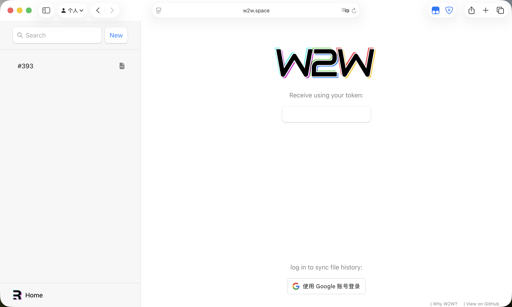
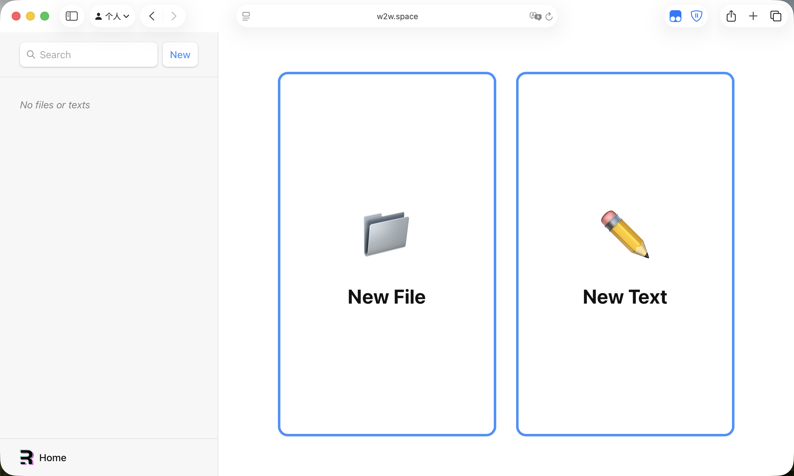
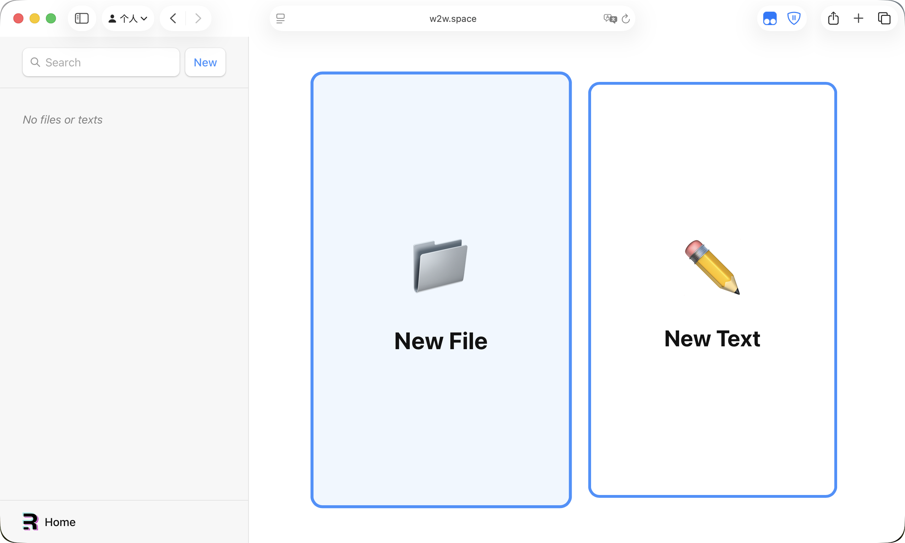
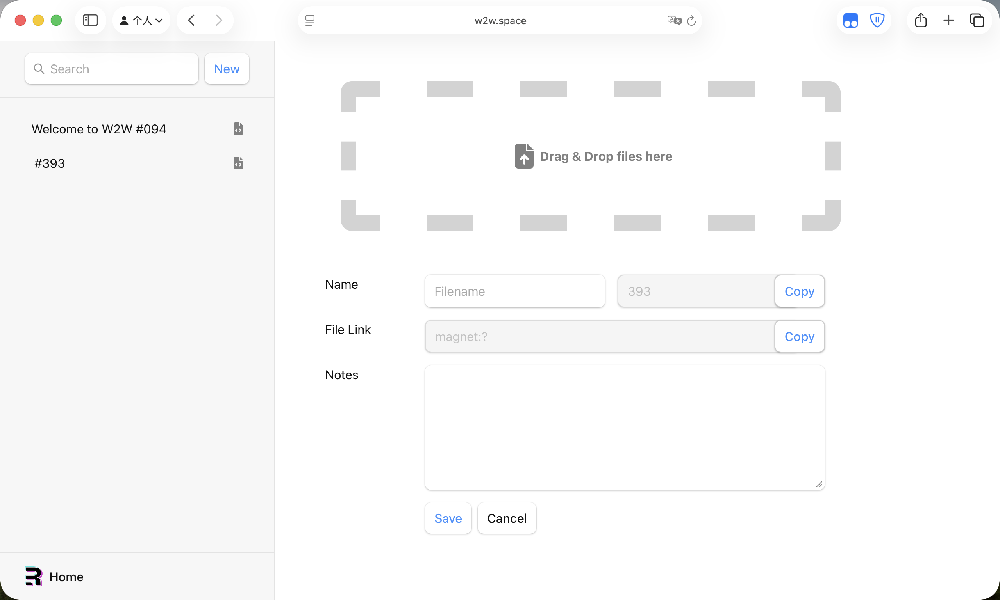
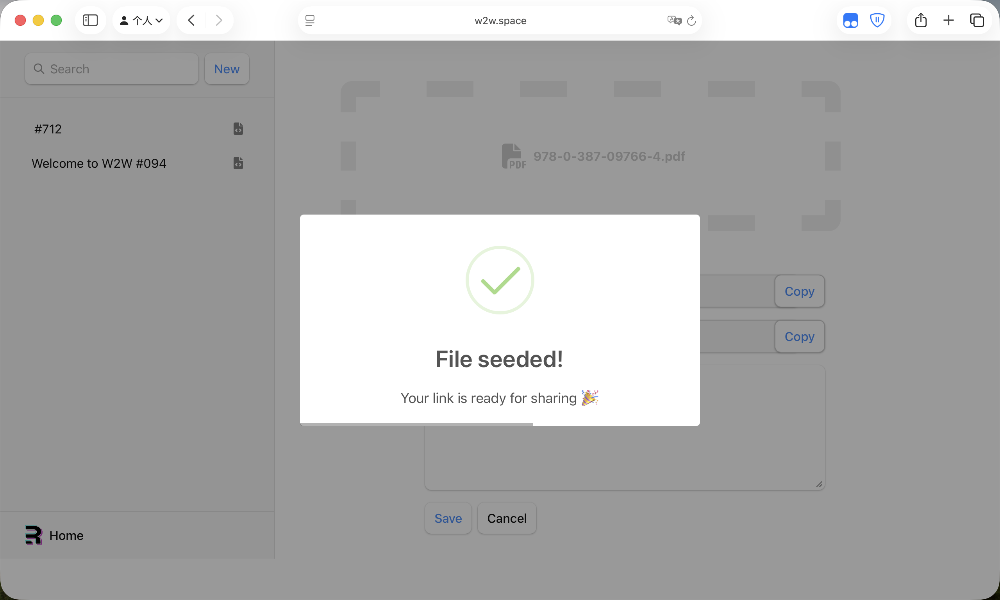
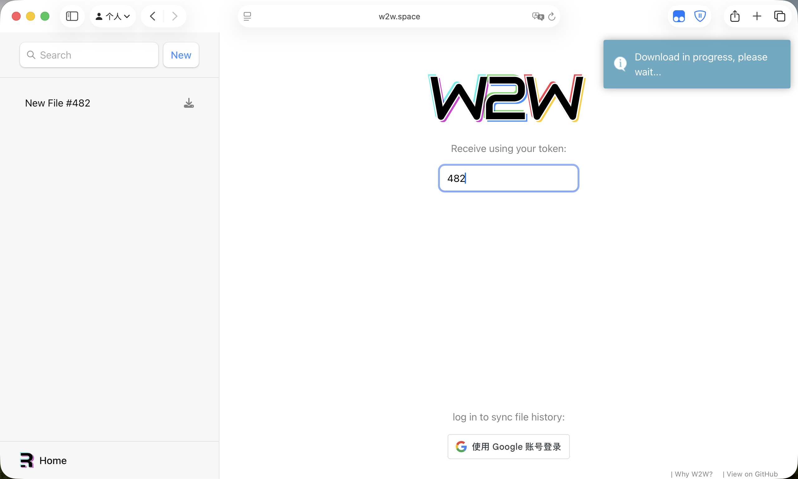
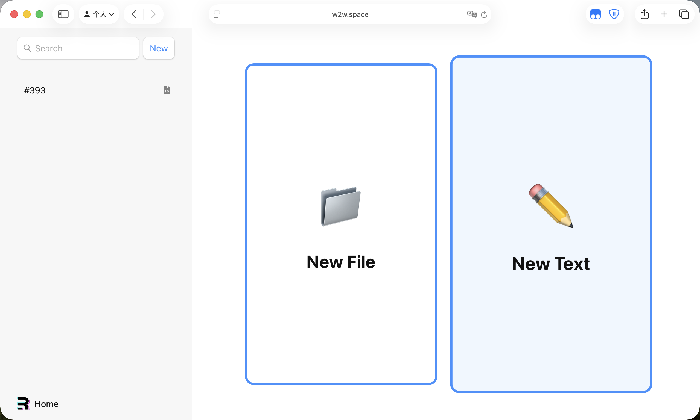
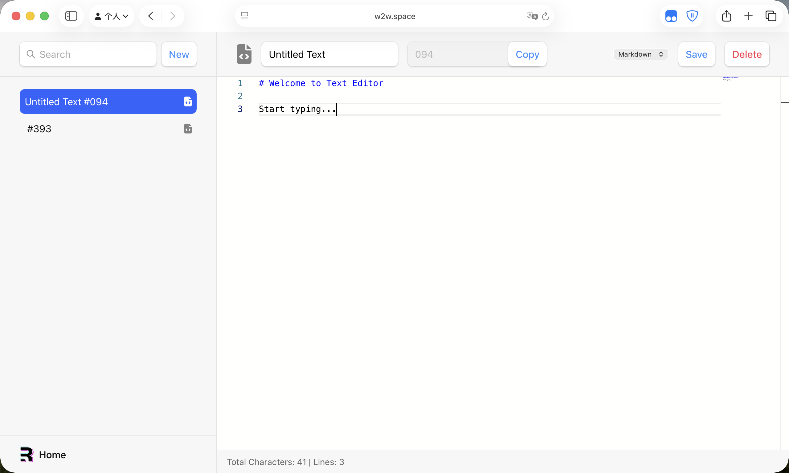
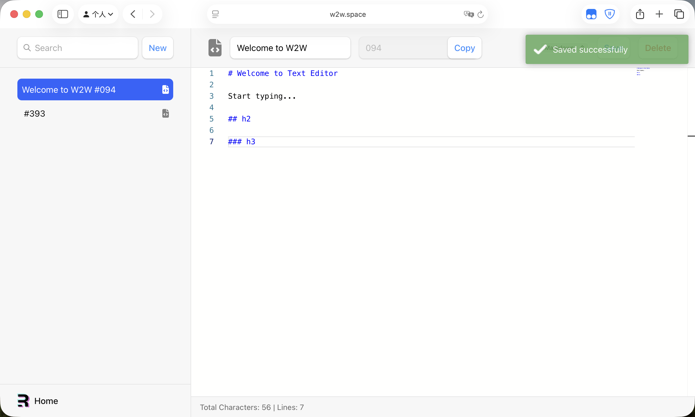
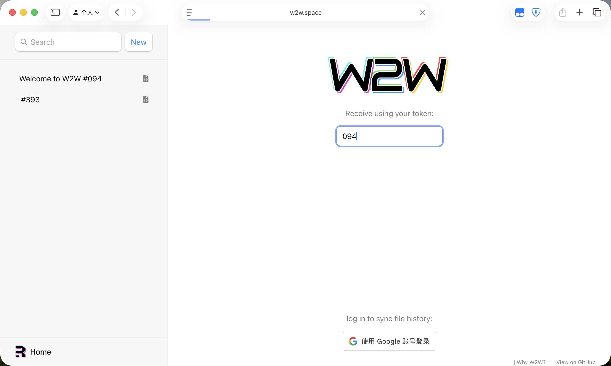

# 🌐 WebToWeb (W2W)

[](https://github.com/JANERUBBISHTOEAT/W2W.SPACE/actions/workflows/deploy.yml?query=branch%3Amain+event%3Apush)

> A browser-based P2P file sharing application built with Remix and WebTorrent



**WebToWeb** is a secure, fast, and anonymous browser-based file sharing platform that enables direct peer-to-peer file transfers without requiring users to log in to any service or upload files to third-party servers.

🔗 **Live Demo**: [w2w.space](https://w2w.space/)

---

## ✨ Features

- 🚀 **Fast P2P Transfer**: Direct peer-to-peer file sharing using WebTorrent protocol
- 🔒 **Privacy-First**: No login required, no files stored on servers
- 💾 **Large File Support**: No file size limitations
- 🔑 **Token-Based Access**: Simple 1–6 digit code for finding a shared file or text
- 🎨 **Modern UI**: Clean and intuitive user interface built with Remix
- ⚡ **Real-Time Progress**: Live transfer progress with peer information
- 🌍 **Browser-Based**: Works in all modern browsers (Chrome, Firefox, Safari, Edge)

---

## 🎯 Use Cases

Perfect for transferring files to public computers:

- **University Labs**: Share files without logging into cloud services
- **Library Computers**: Transfer files securely without accounts
- **Classroom Presentations**: Quick file sharing during presentations
- **Temporary File Exchange**: One-time secure file transfers

<!-- Stable target for the application's footer on GitHub Pages and GitHub. -->
<a id="why-w2w"></a>

### Why WebToWeb over alternatives?

✅ **No Login Required** - Keep your accounts safe  
✅ **No File Storage** - Direct P2P transfer, no third-party servers  
✅ **No Upload Wait** - Download starts immediately  
✅ **No Size Limits** - Transfer files of any size  
✅ **No Speed Limits** - Full bandwidth utilization  
✅ **Short Tokens** - Simple 1–6 digit codes instead of long URLs

---

## 📸 Screenshots

<!-- Jekyll needs markdown="1" to render Markdown inside HTML disclosure blocks. -->
<details markdown="1">
<summary>📊 Dashboard</summary>

The dashboard shows this browser’s personal file records. Names, notes and favorites stay in this browser; removing a record does not remove a shared resource.


</details>

<details markdown="1">
<summary>🔄 Two-Way Sharing</summary>

File or text can be shared with a single click, providing seamless peer-to-peer transfer.



</details>

<details markdown="1">
<summary>📄 File Sharing</summary>

#### New File

Create a local file draft, then select a file to seed. Its sharing token appears only after the magnet is ready.



#### Seed File

Seed the file to the P2P network



..and get a token



#### Download File

Get files by entering the token code.



<!-- TODO: add download screenshot -->
<!-- ..and downloaded -->

</details>

<details markdown="1">
<summary>📝 Text Sharing</summary>

#### New Text

Create and share text snippets instantly.



#### Edit Text

Full-featured VS Code's editor ([Monaco Editor](https://github.com/microsoft/monaco-editor)) embedded in browser.



#### Save Text

Anyone holding the text link can save its shared content; the document keeps the same ID.



#### Retrieve Text

Retrieve text by entering the token code.



</details>

---

See the [anonymous Share model](docs/SHARES.md) for identity, expiry, private file records and the intentional reset of legacy share links. Screenshots below document the existing visual design; labels reflecting ownership and personal text metadata have changed.

## 🚀 Quick Start

### Local development and validation

Use Node.js **24.22.1**, npm **11.19.1**, and Redis. The maintained application is in `remix/`; the obsolete `POC/` implementation has been removed.

Follow the [development guide](remix/README.md) for a frozen dependency installation, explicit Redis ports, startup, and regression tests. The development server uses port **5173**. Production requires a securely configured session secret.

See [compatibility findings](docs/COMPATIBILITY.md) for tested versions and remaining upstream advisories, and [release/rollback instructions](docs/RELEASE.md) before publishing. Release tooling validates the exact commit and replaces only the application service.

GitHub Actions automatically runs that release pipeline on pushes to `main` and
supports manual runs from the Actions tab. Set the SSH address with the
`DEPLOY_SERVER` environment variable (for example, `user@w2w.space`); no server IP
is embedded in the deployment script. See the [Actions configuration](docs/RELEASE.md#github-actions-automation)
for the required repository variables, registry credentials and trusted SSH key.

---

## 🛠️ Tech Stack

- **Framework**: [Remix](https://remix.run/) - Full-stack web framework
- **P2P Engine**: [WebTorrent](https://github.com/webtorrent/webtorrent) - Peer-to-peer file sharing
- **Editor**: Monaco Editor - VS Code's editor embedded in browser
- **Database**: Redis - Fast, in-memory data store
- **OAuth**: Google OAuth 2.0 - Secure authentication
- **Styling**: CSS3 with custom design
- **Icons**: Font Awesome

---

## 📁 Project Structure

```
CSCC09-24F-Project/
├── remix/                    # Main application
│   ├── app/
│   │   ├── routes/          # Remix routes
│   │   └── utils/           # Server utilities
│   ├── public/              # Static assets
│   └── dockerfile           # Container configuration
├── deploy.sh                # Automated deployment script
└── img/                     # Screenshots and assets
```

---

## 📝 Available Scripts

- `npm run dev` - Start development server
- `npm run build` - Build for production
- `npm run start` - Start production server
- `./deploy-auto.sh` - Explicit verify/build/publish/release/rollback actions (see the release guide)

---

## ⚠️ Limitations

- **WebRTC Required**: Works in modern browsers (Chrome, Firefox, Safari, Edge, Opera)
- **Both Devices Online**: Requires both sender and receiver to be online simultaneously
- **Network Restrictions**: May not work on heavily firewalled networks (corporate, university networks)
- **Public Protocol**: Files are shared via public magnet links; short tokens are convenience codes, not authentication
- **No Offline File Storage**: File bytes remain on peers; metadata and text shares expire after 30 idle days
- **Browser-Local History**: Personal file names, notes and favorites are stored only in this browser; optional Google login does not sync them

---

## 🤝 Contributing

Contributions are welcome! Please feel free to submit a Pull Request.

---

## 📄 License

This project is licensed under the MIT License.

---

## 🙏 Acknowledgments

This project was developed as part of the **CSCC09** course project at the **University of Toronto Scarborough (UTSC)**, under the supervision of **Prof. Thierry Sans**.

- Course: [CSCC09 - Web Development](https://thierrysans.me/CSCC09/)
- Institution: [UTSC](https://www.utsc.utoronto.ca/cms/)
- Professor: [Prof. Thierry Sans](https://thierrysans.me/)

---

<div align="center">
Made with ❤️ by the CSCC09 Team
</div>
